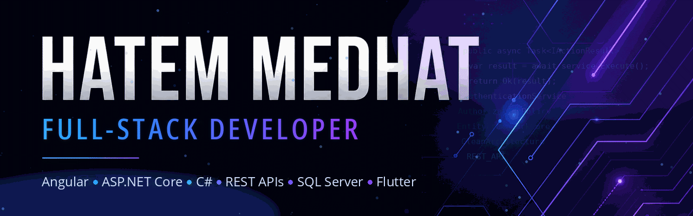

  

# Hatem Medhat

  

  Building modern web applications, scalable APIs, and maintainable software solutions across the frontend and backend.

  

---

## About Me

  <strong>Full-Stack Developer building modern, secure, scalable, and maintainable applications.</strong>

  I work across the full development lifecycle, from building modern web interfaces with <strong>Angular</strong> to developing robust backend services with <strong>ASP.NET Core</strong>, RESTful APIs, and SQL Server. I also work with React and develop mobile applications using Flutter.

  <strong>Frontend Development</strong> ·
  <strong>Backend Engineering</strong> ·
  <strong>Database Design</strong> ·
  <strong>API Integration</strong> ·
  <strong>System Architecture</strong>

---

## Core Expertise

  
  
  
  
  
  

  <strong>Full-Stack Development</strong> ·
  <strong>Clean Architecture</strong> ·
  <strong>Authentication & Authorization</strong> ·
  <strong>Database Design</strong> ·
  <strong>Secure Systems</strong>

---

## Engineering Focus

  
  
  
  

  Designing software with a balance of <strong>performance, security, maintainability, and usability</strong>, from user interfaces to database operations.

---

## Tech Stack

### 🎨 Frontend Development

  

  
  
  
  
  
  

### ⚙️ Backend Development

  

  
  
  
  

### 🗄️ Database

  
    
  
  

### 📱 Mobile Development

  
    
  
  

### 🛠️ Developer Tools & Infrastructure

  
    
  
  
  

---

## Architecture & Engineering

  
  
  
  
  

---

## Featured Projects

### 🎓 Capstone Management System

A project and task management platform designed to support capstone teams, task assignments, submission reviews, deadlines, and structured resubmission workflows.

**Highlights:**
- Team-based task submission and tracking.
- Submission review and rejection workflows.
- Reopening rejected submissions with new deadlines.
- Sequential resubmissions with dedicated status indicators.
- Deadline-aware editing and resubmission handling.
- Team submission management and task status tracking.

**Technologies:** `ASP.NET Core` · `C#` · `SQL Server` · `REST APIs` · `Web Development`

**Repository:** Private team project.

---

### 🎓 Admission System

A student admission and administration system designed to organize student-related workflows, applications, records, and account provisioning.

**Highlights:**
- Student application and record management.
- Student account provisioning and role assignment.
- Bulk data processing and validation.
- Class assignment and student information management.
- Improved consistency between student records and related system data.

**Technologies:** `ASP.NET Core` · `C#` · `SQL Server` · `Entity Framework Core` · `Excel Integration`

**Repository:** Private team project.

---

### ⚖️ ElSewedy Judge System — Online Programming Judge

A web-based programming judge system integrating an ASP.NET Core backend with the **DMOJ judging engine** to support programming problems, submissions, and automated evaluation.

**Highlights:**
- Integration between the web application and judging engine.
- Problem package importing and ZIP processing.
- Submission filtering and judging-result verification.
- Development and testing of the judging adapter.
- Support for C, C++17, Python, Java, C#, Go, Rust, and Kotlin.

**Technologies:** `ASP.NET Core` · `C#` · `SQL Server` · `DMOJ Judge Server` · `Debian Linux`

**Repository:** Private team project.

---

### 📊 School Attendance System

An attendance management system for recording student attendance and generating reports for school staff.

**Highlights:**
- Attendance-taking and absence tracking workflows.
- Reconciliation of attendance records with exported reports.
- Handling of unknown or unnamed student records.
- Distinguishing between students who are not absent and sessions where attendance has not been taken.
- Improvements to report accuracy and export reliability.

**Focus:** `Attendance Management` · `Reporting` · `Data Validation` · `Excel Export`

**Repository:** Private team project.

---

### 🔐 CAS Login Backend — Central Authentication Service

A centralized authentication and authorization backend designed to integrate multiple applications through a shared sign-in service.

**Highlights:**
- Centralized authentication across connected systems.
- Account-to-role mapping and authorization.
- Single sign-on token handling and per-system JWT generation.
- Separation of identity information and application-specific user profiles.

**Technologies:** `C#` · `ASP.NET Core` · `JWT` · `Entity Framework Core` · `SQL Server` · `REST APIs`

---

### 🛍️ Creators Corner — E-Commerce Mobile Application

A mobile e-commerce platform designed to connect customers with local brands through product discovery, comparison, purchasing, delivery, ratings, and communication.

**Highlights:**
- Product discovery and comparison.
- Customer purchasing and delivery workflows.
- Ratings and communication features.
- Mobile frontend and backend API integration.

**Technologies:** `Flutter` · `Dart` · `ASP.NET Core` · `REST APIs` · `SQL Server`

---

### 🗳️ SUE — Students Union Elections System

An elections-related web system developed to support digital election workflows and provide a centralized interface for the platform.

**Focus:** `Web Application Development` · `Digital Workflows` · `System Delivery`

**Repository:** Team project.

---

### 🛒 E-Commerce Web API

A backend-focused e-commerce API built around RESTful services, business logic, database operations, and maintainable application architecture.

**Highlights:** Product management · Business logic · Database integration · RESTful endpoints · API documentation

**Technologies:** `C#` · `ASP.NET Core` · `Entity Framework Core` · `SQL Server` · `REST APIs`

---

### 🖥️ Gym Management System

A desktop management application for handling gym members, subscriptions, attendance, subscription freezing, and operational records.

**Technologies:** `C#` · `WPF` · `EPPlus` · `Excel`

---

### 💃 Dance Station Management System

A Flutter mobile application project with an ASP.NET Core Web API backend, planned around dance-studio management workflows.

**Architecture:** Clean Architecture · Riverpod · Dio · GoRouter · Secure Local Storage

**Technologies:** `Flutter` · `Dart` · `ASP.NET Core` · `REST APIs`

---

### 🌐 ElSewedy IATS Portfolio

A professional portfolio website for ElSewedy IATS, showcasing the school, its departments, activities, projects, achievements, and educational environment through a responsive web experience.

**Technologies:** `HTML` · `CSS` · `JavaScript` · `Responsive Design`

---

### ⚡ ElSewedy Electrometer Portfolio

A corporate portfolio website created to showcase ElSewedy Electrometer, its business profile, services, projects, and digital presence.

**Technologies:** `HTML` · `CSS` · `JavaScript` · `Responsive Design`

---

  <i>Some projects are maintained in private repositories and are not publicly accessible.</i>

---

## GitHub Contributions

  

---

## Connect With Me

  
  &nbsp;&nbsp;&nbsp;
  
  &nbsp;&nbsp;&nbsp;
  
  &nbsp;&nbsp;&nbsp;
  
  &nbsp;&nbsp;&nbsp;
  

  
  &nbsp;&nbsp;
  
  &nbsp;&nbsp;
  

  <i>Open to building interesting software and meaningful projects.</i>

---

  

